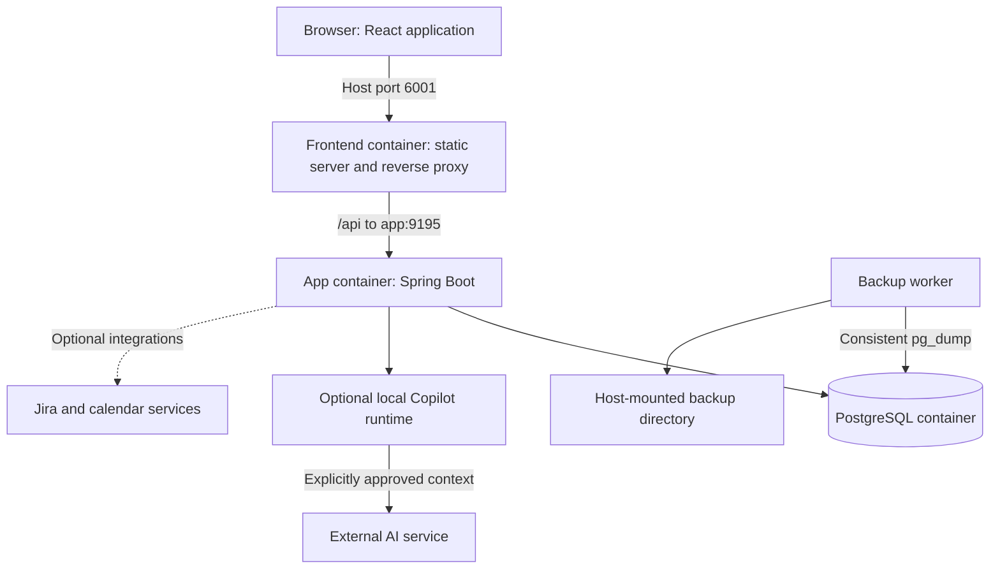

# Work Brain - Overall System and Domain Design

Status: proposed implementation plan. This document describes intended behavior,
not features that have already been implemented.

## 1. Goals and Constraints

Work Brain helps an individual software engineer manage personal implementation
work, team delegation, stakeholder commitments, requirements, meetings, and
planning without repeatedly reconstructing context.

The system must:

- Capture a thought quickly without requiring classification.
- Distinguish personal actions from delegated work and external dependencies.
- Connect tasks, stories, notes, decisions, and project context.
- Preserve literal brain dumps and code snippets.
- Protect focus time and expose commitments that exceed available capacity.
- Operate locally without AI or an internet connection during normal core use.
- Persist successful saves immediately and create recoverable hourly backups.
- Make Copilot optional, off by default, and explicitly controllable per workflow.
- Run the backend and PostgreSQL in Docker.

The initial system is single-user and single-workspace. It is not a replacement
for Jira, a team collaboration platform, or an autonomous project manager.
Machine learning is not required for the core design.

## 2. Architecture and Deployment

Use a modular monolith: one Spring Boot application, one PostgreSQL database,
a frontend static server/reverse proxy, and an independent backup worker. Domain
packages are code boundaries, not separate deployment units.



| Component | Responsibility | Persistence |
| --- | --- | --- |
| React 19 frontend | Capture, editing, views, planning, and review; host port 6001 | Backend owns durable application state |
| Frontend static server | Serve built React files and proxy `/api` to Spring Boot | No business data |
| Spring Boot 3.x / Java 21 | REST API on port 9195, domain behavior, transactions, and bounded workers | PostgreSQL |
| PostgreSQL 18 | Relational data, transactions, full-text search, durable job state | Host-mounted data directory |
| Backup worker | Hourly archives, retention, and independent backup metadata | Host-mounted backup directory |
| Optional Copilot runtime | Supported SDK transport and selected AI work | Credentials supplied separately as runtime secrets |

The frontend serves the built React application at `/` on host port `6001`;
REST endpoints use `/api` and are reverse-proxied to Spring Boot on port `9195`.
Publish frontend and backend ports on `127.0.0.1` only in local single-user mode.
The frontend container can serve HTTP internally on port 80, published as
`127.0.0.1:6001:80`. Publish Spring Boot as `127.0.0.1:9195:9195`.
PostgreSQL need not publish a host port for normal operation; an explicit
development override can expose it on loopback.

For development, Vite uses port `6001` with strict port selection and proxies
`/api` to the backend on `9195`. Browser code uses relative API URLs rather than
Docker service names. Avoid port `6000`, which browsers commonly restrict.

PostgreSQL 18's data mount targets `/var/lib/postgresql`. Pin the image major
version; do not upgrade majors by merely changing an image tag.

No Redis, message broker, vector database, separate search service, or generic
workflow engine is needed.

## 3. Domain Map

These are logical responsibilities. Small related responsibilities may share a
package until their complexity justifies separation.

| Context | Owns | Main collaborators | First phase |
| --- | --- | --- | --- |
| Workspace and preferences | Local preferences, time zone, global AI permission | Planning, Copilot | 1 |
| Capture | Brain dumps, inbox processing, source preservation | Projects, work, stories, knowledge | 1 |
| Projects | Project identity, grouping, lifecycle | All work and knowledge views | 2 |
| People | Self identity, contacts, stakeholder references | Work, notes, projects | 2 |
| Work management | Commitments, assignment, dependencies, follow-ups | Projects, people, capture, planning | 2 |
| Knowledge and search | Notes, decisions, meeting records, searchable read views | Projects, work, capture, stories | 3 |
| Stories | Manually editable requirements and acceptance criteria | Capture, projects, work, Copilot | 3 |
| Focus and checkpoints | Work sessions and resumption context | Work, projects, planning | 3 |
| Planning | Availability, time blocks, daily plans, capacity analysis | Work, focus, preferences | 4 |
| Copilot add-on | Approved generation jobs and proposed output | Preferences, capture, notes, stories | 5 |
| External integrations | Connections, external references, synchronization state | Stories, work, planning | 6 |
| Operations and recovery | Backups, restore procedure, operational health | Database and deployment | 1 |

Business contexts own their mutations. Another context calls the owning service
instead of directly modifying its repositories.

Use UUID references between aggregates rather than large bidirectional JPA
object graphs. Enforce real database foreign keys for local references. A shared
database permits short cross-context transactions when an operation genuinely
must be atomic; it does not justify unrestricted cross-context writes.

Search and dashboard read queries may join contexts through dedicated read
projections. Do not turn those read projections into another write model.

## 4. Shared Data and API Rules

### Persistence and consistency

- Mutable aggregates carry `id`, `created_at`, `updated_at`, and an optimistic
  locking `version` where concurrent edits are possible.
- PostgreSQL UUID columns map to Java UUID. Instants map to `timestamptz`.
- Date-only deadlines use `date`; they must not silently become midnight UTC.
  The workspace time zone determines local-day interpretation.
- Use short transactions, explicit read-only query transactions, and database
  constraints for enforceable invariants.
- Do not hold a database transaction while waiting for AI or another service.
- Keep Flyway migrations append-only in `infra/flyway/`, packaged under
  `db/migration`.
- Retain archived references. Avoid cascading deletion of a project's work or
  a person's historical commitments.

### API contract

All routes below are proposed resource groups, not an instruction to generate
every endpoint before its delivery phase.

- Controllers delegate directly to context services.
- Request and response payloads are Java records, never exposed JPA entities.
- List endpoints have bounded pagination, allowlisted filters and sorting, and
  stable ordering with an ID tie-breaker.
- Use a consistent page shape with items and pagination metadata instead of
  depending on framework-specific entity serialization.
- Edits supply the expected aggregate version. Conflicts return 409 and preserve
  the editor's unsaved text for explicit resolution.
- Retryable create, convert, and accept operations use a stable client operation
  ID. Persist uniqueness and the request fingerprint with the owning operation.
  Replaying the same operation returns its original result; reusing its key for
  different input returns 409.
- Errors use `ProblemDetail`, a stable application error code, and field errors
  when appropriate. Handle them through `GlobalExceptionHandler`.
- Malformed input returns 400; missing resources return 404; invalid state or
  stale-version operations return 409; oversized input returns 413.
- Bound string lengths and request sizes. Never silently truncate content.

### Text fidelity

Literal notes, brain dumps, and code pass through explicit validation without
HTML tag stripping. React renders them as escaped text. Actual rich HTML fields,
if introduced, use allowlist sanitization through `@SanitizeHtml`.

Use `@SanitizePlainText` only for fields explicitly defined as tag-stripped
text. Do not apply an HTML parser to every string indiscriminately.

## 5. Domain Designs

### 5.1 Workspace and Preferences

**Purpose:** hold the small amount of application-wide personal configuration.

**Data:** one `workspace_settings` record with time zone, working preferences,
global Copilot permission, an AI permission revision, and optimistic version.
Do not add multi-tenant ownership columns throughout the schema for a hypothetical
future team product.

**Behavior and invariants:**

- Copilot permission defaults to false.
- Separate user permission from runtime capability: enabled permission is not
  proof of authentication, available models, or account authorization.
- Before the integration exists, show an unavailable/off state rather than a
  working-looking toggle backed by a fake provider.
- Updating global AI permission is a backend operation, not just browser state.
- Keep UI preferences separate from credentials. No credentials enter this table.
- Planning uses an explicit IANA time zone; daylight-saving transitions must not
  be reduced to a fixed UTC offset.

**API/UI:** `/api/settings`, capability/status information, persistent header
Copilot control, and a settings page. JWT and Keycloak are deferred; local access
is an explicitly selected deployment profile, not a per-screen bypass.

**Delivery:** basic settings in phase 1; planning preferences in phase 4; actual
Copilot permission enforcement and capability reporting in phase 5.

### 5.2 Capture and Inbox

**Purpose:** make recording a thought faster than deciding where it belongs.

**Data:** `capture_entry` owns original text, editable working text, optional title,
processing state, optional project reference, timestamps, and version.

The original submitted text remains intact. Editing the working copy does not
erase the original. This is source preservation, not a general-purpose revision
history system.

**Lifecycle:** `INBOX -> PROCESSED` or `ARCHIVED`; allow explicit reopening.
Processing does not mean the resulting task is complete.

**Behavior and invariants:**

- Capturing requires no project, assignee, priority, or AI choice.
- Save text independently of any later conversion.
- Convert a capture into one or more work items, a note, or a story while retaining
  typed source references on the created records.
- Conversion creates the target and updates capture processing state in one
  short transaction. A failed conversion leaves the original capture usable.
- Multiple outputs are intentional operations, not duplicate retries.
- Global Copilot off never blocks capture, editing, or manual conversion.

**API/UI:** `/api/captures`, capture detail/edit, inbox filters, and explicit
conversion actions. A quick-capture panel stays reachable from every main view.

**Delivery:** capture/list/edit/archive in phase 1; task conversion in phase 2;
note and manual-story conversion in phase 3; optional generation in phase 5.

### 5.3 Projects

**Purpose:** provide shared context for related commitments and knowledge.

**Data:** `project` contains name, description, lifecycle, and optional external
reference links. Work items, stories, captures, and notes refer to projects.

**Lifecycle:** `ACTIVE -> ON_HOLD` or `ARCHIVED`, with explicit reactivation.

**Behavior and invariants:**

- A project is a grouping boundary, not a database ownership partition.
- Archiving hides it from default active views without deleting its contents.
- Project views aggregate work, waiting-on items, notes, decisions, and stories;
  they do not maintain duplicate copies of those records.
- Cross-project task dependencies are allowed and remain visible.
- Do not add a second sprint-management system before a concrete Jira integration
  requirement exists.

**API/UI:** `/api/projects`, project overview, filtered work and knowledge tabs.

**Delivery:** phase 2, extended by subsequent contexts.

### 5.4 People and Stakeholder Context

**Purpose:** identify who owns work, who is waiting, and whom to follow up with.

**Data:** `person` with display name, optional contact reference, active/archive
state, and a self marker. Add typed project or work stakeholder relationships
only when a workflow needs them.

**Behavior and invariants:**

- Exactly one designated self identity exists once assignment is introduced.
- Contacts are references, not login accounts or an employee directory.
- Assignee and stakeholder are different relationships.
- Archiving a contact preserves historical ownership and commitments.
- Contact details are optional; avoid collecting unnecessary personal data.

**API/UI:** `/api/people`, lightweight contact editing, assignee selectors, and
person-based waiting-on views.

**Delivery:** phase 2. Team capacity prediction and performance scoring are out
of scope.

### 5.5 Work Management and Delegation

**Purpose:** track actionable commitments without confusing other people's work
with tasks the user must execute personally.

**Data:**

- `work_item`: title, description, project, assignee, priority, date-only deadline,
  optional effort estimate, next action, follow-up timestamp, lifecycle, source
  capture/story references, and version.
- `work_item_dependency`: prerequisite and dependent item IDs.
- Typed stakeholder links when expectation tracking is added.

**Lifecycle:** `TODO`, `IN_PROGRESS`, `WAITING`, `DONE`, `CANCELLED`. Reopening is
an explicit domain operation. Blocking is derived from unresolved prerequisites
and any explicit blocker explanation, rather than a second inconsistent status.

**Behavior and invariants:**

- Assignment to a teammate changes ownership of the existing commitment; it does
  not create a second personal task that needs manual synchronization.
- Delegated-work views include non-self assignments. Follow-up dates identify
  when the user should act on those commitments.
- Waiting can mean a decision, external response, review, or another dependency;
  record an actionable explanation rather than only a status.
- Reject self-dependencies and cycles.
- Serialize dependency-graph mutations with a transaction-scoped PostgreSQL
  advisory lock before cycle checking. Item versions alone cannot prevent
  concurrent opposite-edge inserts from creating a cycle.
- An unresolved cancelled prerequisite remains an explicit problem until its
  dependency is removed or replaced; do not treat cancellation as completion.
- Do not permit a blocked item to become an executable ready task silently.
  Completing despite a prerequisite requires explicitly resolving the dependency.
- Reminders initially appear in the application. Do not promise OS notifications
  while the application or Docker is stopped.

**API/UI:** `/api/work-items`, assignment and lifecycle commands, dependency
operations, My Work, Waiting On, and Follow-ups views.

**Delivery:** phase 2. Scheduling remains a separate responsibility.

### 5.6 Knowledge, Decisions, and Search

**Purpose:** preserve the reasoning and context behind work, not just its status.

**Data:** `note` with kind `REFERENCE`, `MEETING`, or `DECISION`; title, literal
body, optional project, source capture, timestamps, and version. Add typed
`note_work_item` and `note_story` links when those associations are needed.

**Behavior and invariants:**

- Decisions use an editable structure for context, decision, rationale, and
  consequences; they are not inferred facts.
- Meeting notes can link to resulting work without pretending every sentence is
  an action item.
- Notes do not own task completion or story readiness.
- Start with plain text. Introduce rich HTML only for an actual editing need.
- Archive rather than cascading deletion into linked knowledge.

**Search:** a dedicated read service combines bounded PostgreSQL full-text
queries over captures, work items, notes, and stories. Return typed results with
resource ID, title, plain-text excerpt, and relevance. Use GIN indexes and a
configuration appropriate to technical text; start with `simple`.

Keep canonical content in its domain tables. Do not introduce an independent
search store or generic polymorphic entity table. Return plain excerpts or
structured highlight offsets, not executable HTML snippets.

**API/UI:** `/api/notes`, `/api/search`, project notebooks, decision views, and a
global search surface.

**Delivery:** phase 3. Semantic search, embeddings, and automatic clustering are
not initial requirements.

### 5.7 Stories and Requirements

**Purpose:** turn incomplete thoughts into reviewable requirements, with or
without AI.

**Data:**

- `story_draft`: project, title, problem/context, actor, desired outcome, scope,
  open questions, lifecycle, source capture, and version.
- `story_acceptance_criterion`: stable criterion ID, story reference, ordered
  position, and text.
- Typed links to implementation work items.

**Lifecycle:** `DRAFT -> READY`, with revision back to `DRAFT` and archival.
Ready means ready for the user's workflow, not already implemented.

**Behavior and invariants:**

- Incomplete drafts are valid saves. Readiness has separate validation.
- Manual creation and editing are always available.
- An explicit readiness transition requires a title, outcome/description,
  acceptance criteria, and resolution of questions marked blocking.
- Story criteria and work status are different concepts; checking off a task does
  not automatically establish business acceptance.
- Creating implementation tasks does not duplicate the story as a task.
- AI proposals remain separate until accepted. Acceptance never replaces the
  source brain dump and never silently overwrites a newer story edit.

**API/UI:** `/api/stories`, criterion editing, explicit readiness commands, source
links, and a structured manual story editor.

**Delivery:** phase 3; AI assistance in phase 5; explicit Jira export in phase 6.

### 5.8 Focus Sessions and Context Checkpoints

**Purpose:** lower the cost of returning to interrupted implementation work.

**Data:** `focus_session` with work-item reference, actual start/end instants and
state; `context_checkpoint` with where-I-stopped, next step, blocker, branch
reference, and relevant links.

**Behavior and invariants:**

- A planned focus block is not proof a focus session actually happened.
- Only one session may be active locally; enforce this with a partial unique
  database index, not just a disabled frontend button.
- Switching tasks can save a checkpoint and finish/pause the current session.
- A crash leaves an interrupted session to reconcile on restart. Do not count the
  entire period the laptop was asleep or the app was unavailable as focused work.
- Branch and file references are informational. Opening a checkpoint does not
  authorize filesystem access or shell execution.
- Retain checkpoint history so a newer interruption does not erase useful context.

**API/UI:** `/api/focus-sessions`, `/api/checkpoints`, a compact active-session
indicator, and a Resume Work panel on work-item detail.

**Delivery:** phase 3; link planned blocks in phase 4.

### 5.9 Daily Planning and Capacity

**Purpose:** propose a feasible plan around meetings and protected coding time.

**Data:** working-hour rules, `daily_plan`, `time_block`, and bounded planning
preferences. Time blocks represent meetings, fixed commitments, focus work,
coordination batches, breaks, or buffers. A plan records its local date and time
zone; block boundaries are instants.

**Scheduling strategy:**

1. Expand working hours for the selected local dates, handling daylight-saving
   transitions explicitly.
2. Subtract fixed meetings, breaks, buffers, and manually locked blocks.
3. Exclude completed work, unresolved blockers, and tasks not executable by self.
4. Separate hard date constraints from preferences. Flag deadlines that cannot
   fit rather than relaxing them invisibly.
5. Rank remaining candidates deterministically by explicit priority, due-date
   urgency, downstream blocking impact, and overdue follow-up needs.
6. Fit estimated work to suitable gaps, preferring longer contiguous blocks for
   deep work and grouping related coordination tasks.
7. Return proposed blocks, explanations, unscheduled work, and capacity warnings.
   Persist the proposal only after user acceptance.

**Behavior and invariants:**

- No ML model or opaque learned score is required.
- Unknown duration is unknown, not zero; request an estimate or leave the task
  unscheduled with an explanation.
- Do not split a task unless it is marked splittable.
- Do not move locked blocks or alter deadlines to make the plan look feasible.
- Serialize edits to a daily plan and reject overlapping managed blocks.
  External meeting conflicts may be represented, but must be flagged rather
  than hidden.
- Multi-day plan edits lock affected plans in stable order.
- A recommendation is not a commitment until accepted.

**API/UI:** `/api/plans`, `/api/time-blocks`, planning suggestions, a daily agenda,
capacity summary, and unscheduled-work explanations.

**Delivery:** phase 4 with manual meeting entry; calendar import in phase 6.

### 5.10 Copilot Add-on

**Purpose:** enrich already-working workflows without owning their source data.

**Data:** `ai_job` with workflow, typed source reference, source version, explicitly
selected input snapshot, permission revision, state, timestamps, sanitized error
metadata, and proposed result. Use versioned typed JSON payloads where generated
structures vary; do not hide core task or story fields inside arbitrary JSON.

**Lifecycle:** `QUEUED -> RUNNING -> SUCCEEDED` or `FAILED`; queued work may become
`CANCELLED`. Running work may receive a cancellation request. Work left running
after an application crash becomes `INTERRUPTED`, not automatically retried.

**Dispatch and permission rules:**

- Persist source content first; requesting generation is a separate operation.
- Require both global permission and per-operation opt-in.
- A single bounded dispatcher is sufficient initially. Persist job state and
  claim work transactionally; do not build a generic distributed queue.
- Recheck permission immediately before dispatch. Serialize the short dispatch
  handoff against global-disable operations in the single app process.
- Once disable is acknowledged, no new handoffs may begin. A handoff already
  started is in-flight: request cancellation, but do not promise recall of data
  or avoidance of already-incurred usage.
- Cancel queued work when disabled. Late callbacks cannot revive cancelled jobs
  or automatically apply content.
- Keep the permission revision so disabling and re-enabling cannot resurrect
  older queued work unexpectedly.
- Do not hold transactions or a global toggle lock for the duration of inference.
- Do not automatically retry uncertain remote outcomes after a crash.

**Output acceptance:** the relevant Stories or Work service validates the
proposal, checks the source/target version as applicable, and applies it in a
short idempotent transaction. The Copilot module does not directly edit another
context's repositories.

**Runtime:** use the supported Java SDK/runtime inside the app container,
authenticated with the account and credential method of your choice. Confirm
the exact supported noninteractive credential method before implementation.
Never assume a service hostname is itself an LLM API endpoint.

Disable unrelated tools for drafting, bound execution time and concurrency, and
send only selected context. No browser credentials, token extraction from IDEs,
unrestricted shell tools, or background workspace scanning.

**API/UI:** `/api/copilot/status`, `/api/ai-jobs`, job status/cancellation, the
global toggle, per-action opt-in, and proposal review.

**Delivery:** phase 5. Unavailable authentication, policy restrictions, or usage
limits must leave all core operations functional.

### 5.11 External Integrations

**Purpose:** reduce duplicate entry without introducing hidden remote writes.

**Data:** connection configuration without credential values, secret references,
typed external-resource mappings, synchronization cursors, and operation status.
Uniquely identify external resources by connection and provider resource ID.

**Initial boundaries:**

- Jira: explicit story export and linked issue status readback before attempting
  general two-way synchronization.
- Calendar: read-only imports into planning before creating remote events.
- Coding agents: explicit handoff packages containing scope, allowed repository,
  acceptance criteria, and review expectations. Do not start with automatic
  execution inferred from a calendar gap.

**Behavior and invariants:**

- Each integration has its own explicit enabled state and permitted data scope.
  The Copilot toggle does not implicitly authorize Jira or calendar traffic.
- Define authority field by field. Imported calendar details are provider-owned;
  local context and original captures remain locally owned.
- Use bounded polling with visible last-sync and error information.
- Reconcile remote changes before overwriting a linked record. Do not promise
  atomic local/remote transactions.
- If remote creation may have succeeded but its response was lost, record an
  unknown outcome and reconcile before retrying. Do not create duplicate Jira
  issues through blind retries.
- Expand recurring calendar instances within a bounded date range, preserving
  provider identity and original time-zone information.
- Changes that require credentials or network access never block local capture.

**API/UI:** `/api/integrations`, typed provider operations, connection status,
selected-field review, and external links.

**Delivery:** phase 6, one integration at a time. Provider details and API
access are prerequisites, not assumptions.

### 5.12 Operations, Backup, and Recovery

**Purpose:** make saved state durable and recovery understandable.

**Storage layout, relative to the project root:**

```text
runtime/postgres/       Live PostgreSQL data; excluded from source control
backups/               Completed archives and temporary backup work
                       Both excluded from source control
```

Compose paths must resolve to these intended host directories even though the
Compose file is in `infra/docker/`. Do not accidentally create a second database
directory relative to a different working directory.

**Backup behavior:**

- Run independently of the application so an app failure does not disable backup
  scheduling while PostgreSQL remains available.
- Check backup age periodically; make a backup when at least one hour has elapsed
  since the last successful backup, and catch up after restart or sleep.
- Use the matching PostgreSQL client tools and a least-privilege backup account
  with the read permissions required for this database.
- Serialize scheduled and manual backup operations with an exclusive lock.
- Run `pg_dump` in custom format. Never copy a running PGDATA directory.
- Write an archive and manifest under a temporary backup directory, calculate
  its checksum, then atomically rename the directory on the same filesystem.
- Record completion time, database major, application/schema compatibility
  information, and checksum. Do not include credentials or dump cluster roles.
- Apply retention only after successful completion. A proposed starting policy
  is 24 hourly, 7 daily, and 4 weekly recovery points; confirm before rollout.
- Expose stale/failed backup status from the worker's metadata, even after app
  restarts. Restrict host filesystem permissions.

**Recovery procedure:**

1. Preserve the current database and select a completed archive.
2. Verify archive integrity and application/schema compatibility.
3. Provision a fresh database and required roles using separate runtime secrets.
4. Restore schema and data with failure-on-error behavior; reapply the intended
   ownership and grants rather than importing historical role credentials.
5. Start a compatible application against the restored database and inspect its
   health and representative saved records.
6. Switch over deliberately; do not destroy the original recovery source.

Pause backup work around schema upgrades and coordinate migration completion
before recording a new compatible recovery point. Database commits protect normal
restart recovery; backups protect against logical mistakes and data loss. Hourly
backups imply up to an hour of lost changes on restore under healthy scheduling,
not an absolute guarantee during downtime or repeated failures.

No backups run while the laptop/Docker is stopped. Same-disk archives are not
protection against disk failure or laptop loss. A separate storage
location is required for that failure class.

**API/UI:** read-only `/api/operations/status` initially. Restore remains an
explicit documented maintenance action, not a casual destructive browser button.

**Delivery:** phase 1.

## 6. Key End-to-End Workflows

### Capture without AI

1. The UI collects literal text and submits a stable operation ID.
2. Capture validates it, persists the original and working text, and commits.
3. The response acknowledges the saved version.
4. The frontend shows saved state and refreshes affected query caches.

No Copilot initialization, authentication, or request occurs on this path.

### Brain dump to manual story

1. Open an already-saved capture.
2. Enter a story structure manually, keeping incomplete fields as an editable draft.
3. In one short transaction, create the story, preserve its source reference, and
   update capture processing state using the expected version.
4. Later edits to the story do not mutate the original capture.

### Brain dump to Copilot-assisted story

1. Save the brain dump through the same core capture endpoint.
2. Explicitly select context and request generation with AI opt-in.
3. Persist an eligible job and return its status independently of the capture save.
4. Dispatch only if the current global permission still allows it.
5. Show a proposed story or an explicit generation error.
6. Apply the reviewed proposal through the normal Stories service.

Turning AI off or failing at steps 3-6 never rolls back step 1.

### Delegate and follow up

1. Assign a work item to a contact and record the next expected result.
2. Set a follow-up time if the user needs to chase it.
3. Show the item in Waiting On, not as executable personal implementation work.
4. Reschedule the follow-up, reassign, or close the same commitment as appropriate.

### Interrupted implementation

1. Finish or pause the current focus session with a checkpoint.
2. Record where work stopped, the next action, and relevant links.
3. On return, show that checkpoint alongside the task and project context.
4. After a crash, reconcile any interrupted session rather than inflating focus time.

## 7. Storage and Query Strategy

Start with one application schema and migrations introduced with their phase.
Do not create every future table in phase 1.

| Query | Initial indexing strategy |
| --- | --- |
| Capture inbox | Processing state, creation time, ID |
| Personal/delegated work | Assignee, lifecycle, priority/due date as actual query patterns require |
| Due follow-ups | Partial index on active work with a follow-up timestamp |
| Project views | Project reference plus lifecycle/time ordering |
| Dependency traversal | Unique prerequisite/dependent pair and reverse-lookup index |
| Notes and story lists | Project, lifecycle/kind, modification time |
| Full-text search | Per-source GIN search indexes |
| Active focus session | Partial unique index for active state |
| Daily plans | Unique local date for the single workspace |
| AI dispatcher | State, queued time, ID |
| External mappings | Unique connection and provider resource ID |

Use DTO projections or explicit fetch plans. Never fetch an unbounded graph for
the dashboard. Page IDs before loading collections when necessary.

JSONB is appropriate for bounded versioned provider payloads or proposals, not a
substitute for typed relations, lifecycle columns, or searchable core fields.

## 8. Frontend Structure and State Ownership

```text
frontend/src/
  app/                 Routing, providers, application shell
  features/
    capture/
    projects/
    people/
    work/
    knowledge/
    stories/
    focus/
    planning/
    copilot/
    settings/
  components/          Genuinely shared presentation components
  services/            Shared HTTP transport and error handling
```

Feature-local components, hooks, services, validation, types, and tests stay
colocated until sharing is justified.

- Pages compose components and hooks; they do not call HTTP directly.
- Service files own backend communication.
- TanStack Query owns server state. Context owns only genuine shared client
  state, not duplicate copies of tasks and notes.
- Mutation success invalidates the affected detail/list/dashboard queries.
- Editors retain unsaved content on network or version-conflict errors.
- Prevent overlapping saves from applying responses out of order. Acknowledge
  persistence only after a successful backend response.
- Add debounced autosave only with explicit pending/saved/failed states and an
  immediate Save action. Unacknowledged browser-only keystrokes are not durable
  database state; do not claim crash protection for them.
- Avoid optimistic creation or completion that could falsely imply persistence.
- Use loading, error, empty, unavailable, and stale states explicitly.
- The header provides quick capture, global search when available, and the
  Copilot status/control. Views remain usable with Copilot off.

## 9. Security and Dependency Supply

- Local no-auth mode is an explicit profile and must not activate in production.
- Retain CSRF/origin protections even for a local browser-accessible app.
- Use separate runtime credentials for database administration, migrations, app
  queries, and backup as required by their permissions.
- Mount secrets at runtime. Never include them in frontend bundles, POMs,
  `.npmrc`, images, application tables, backups, or logs.
- Resolve Maven dependencies from Maven Central and npm dependencies from the
  public npm registry. Commit lockfiles (`package-lock.json` or `pnpm-lock.yaml`)
  and pin dependency and plugin versions.
- Supply any build authentication without embedding credentials in image
  layers. Do not disable TLS verification.
- Normal core operation does not require registries or external model services
  once images and dependencies have been built.
- Keep logs content-minimal: operation IDs, resource IDs, timing, and safe error
  categories, not complete notes or prompts.
- Remote AI and integrations require explicit scope and explicit opt-in.
  Do not send regulated or sensitive data to a remote service by default.

## 10. Phased Delivery and Exit Criteria

Each phase is a vertical slice: frontend, backend, schema, error handling,
automated coverage, and Docker wiring. Stop at a usable review boundary.

| Phase | Scope | Completion criterion |
| --- | --- | --- |
| 1 | Build/deployment foundation, settings shell, capture, persistence, operations | Save/list/edit/archive a literal capture in Docker; acknowledged data survives restart; hourly backup and fresh-database restore work |
| 2 | Projects, people, commitments, delegation, follow-ups, dependencies | Track self and delegated work separately; prevent dependency cycles; preserve concurrent edits through explicit conflicts |
| 3 | Knowledge, search, manual stories, focus/checkpoints | Convert a saved capture manually without AI; find linked context and resume interrupted work |
| 4 | Availability, daily plans, explainable scheduling | Produce an editable feasible plan, preserve fixed blocks, and report work that cannot fit |
| 5 | Copilot add-on and proposal review | Core workflows work with AI off/unavailable; toggles govern dispatch; failed generation never loses saved input |
| 6 | Individually selected external integrations | Ship one integration at a time with explicit authority, reconciliation, and visible failures |

## 11. Verification Strategy

- Unit-test domain transitions, readiness rules, scheduling, and dependency logic.
- Use Mockito around service collaborators and external boundaries.
- Use PostgreSQL Testcontainers for migrations, constraints, query behavior,
  concurrent updates, and durable job transitions. H2 is not equivalent coverage.
- Use `@JsonTest` for annotation behavior, literal code preservation, malformed
  HTML handling, Unicode, nulls, and size boundaries.
- Cover API pagination, consistent errors, version conflicts, and local-profile
  security behavior.
- Colocate frontend coverage for input preservation, mutation failures, toggles,
  empty states, and conflict resolution.
- Exercise disable-versus-dispatch races, application crashes during generation,
  duplicate submissions, and acceptance of stale proposals.
- Verify backup failures do not replace valid archives and restore into an
  isolated fresh database before relying on a backup mechanism.
- Treat phase exit criteria as observable behavior, not merely successful builds.

## 12. Decisions to Confirm at Their Implementation Phase

These are not reasons to block the local capture foundation.

| Decision | Needed by |
| --- | --- |
| Initial text limits and backup retention policy | Phase 1 rollout |
| Separate-disk backup destination and desired recovery objectives | Operational adoption |
| Working hours, focus-block minimums, and scheduling preferences | Phase 4 |
| Supported container authentication for the chosen AI provider | Phase 5 |
| Permitted AI data categories, model choices, and usage limits | Phase 5 |
| Jira deployment/API access, calendar provider, and sync permissions | Phase 6 |
| Any need for OS-level reminders while the application is not open | Later reminder integration |

Preview Java features, attachment storage, multi-user hosting, generic workflow
engines, automatic agent execution, and full two-way Jira synchronization are not
part of the initial design.
